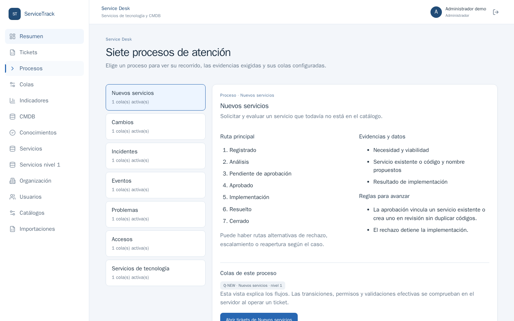

# Cómo mostrar los siete procesos

1. Inicia sesión y pulsa **Procesos** en el menú lateral. La columna izquierda contiene los siete procesos y cuántas colas activas tiene cada uno. La parte derecha muestra su ruta principal, evidencias, reglas y colas.
2. Selecciona **Nuevos servicios**. Explica que hay análisis y aprobación, y que el resultado es vincular un servicio existente o crear uno sin duplicarlo.
3. Selecciona **Cambios**. Señala CI, riesgo, plan de pruebas y reversión. Di: «La API impide ejecutar sin aprobación registrada».
4. Selecciona **Incidentes** y **Eventos**. Distingue la recuperación de un incidente de la evaluación E0–E3; E2/E3 crean o vinculan un incidente.
5. Selecciona **Problemas**, **Accesos** y **Servicios de tecnología**. Señala, respectivamente, causa raíz y cambio vinculado; beneficiario y prohibición de autoaprobación; prestación de un servicio ya existente.
6. Pulsa **Abrir tickets de [proceso]** para pasar de la explicación a casos reales. La lista se abre **con ese proceso ya filtrado**; abre un ticket y enseña su estado, evidencias y botones disponibles. La vista Procesos es explicativa: los controles efectivos viven en el servidor.

La tabla completa de flujos y condiciones está en [PROCESOS.md](PROCESOS.md). La prueba P09 en [PRUEBAS.md](PRUEBAS.md) recorre las siete rutas y rechaza transiciones inválidas; P10 comprueba cambio sin aprobación y autoaprobación de acceso.
