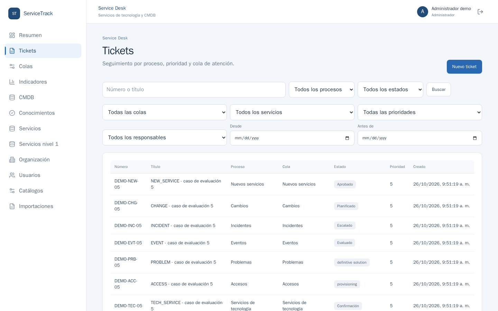
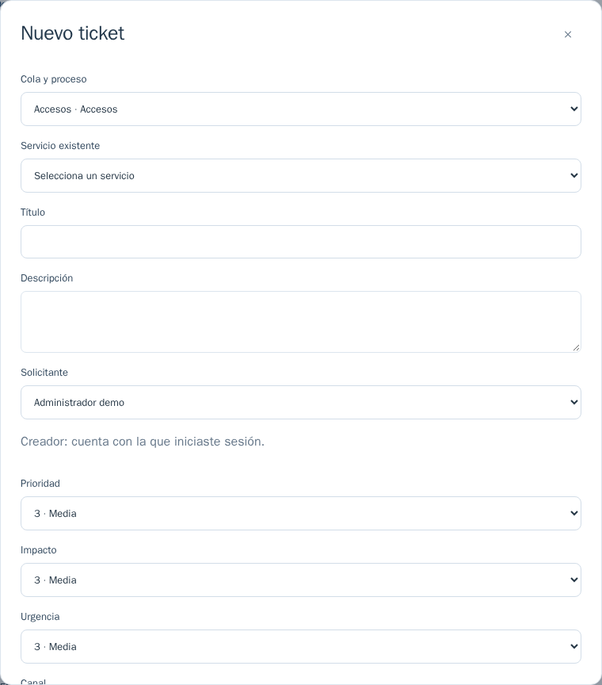
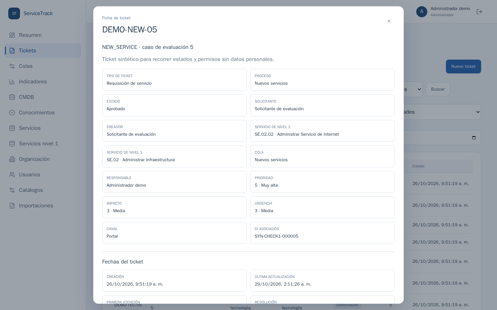
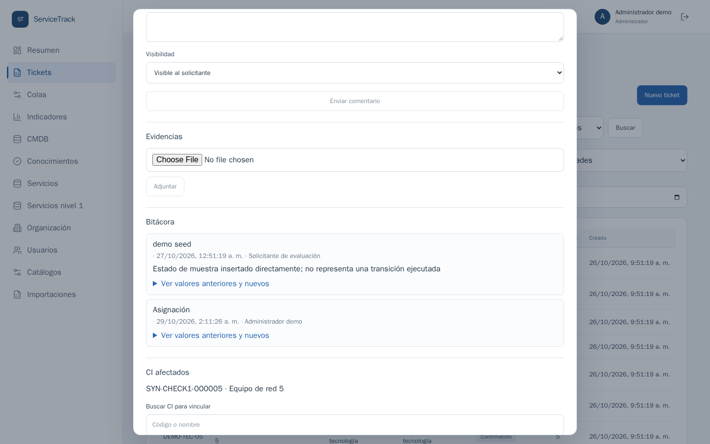
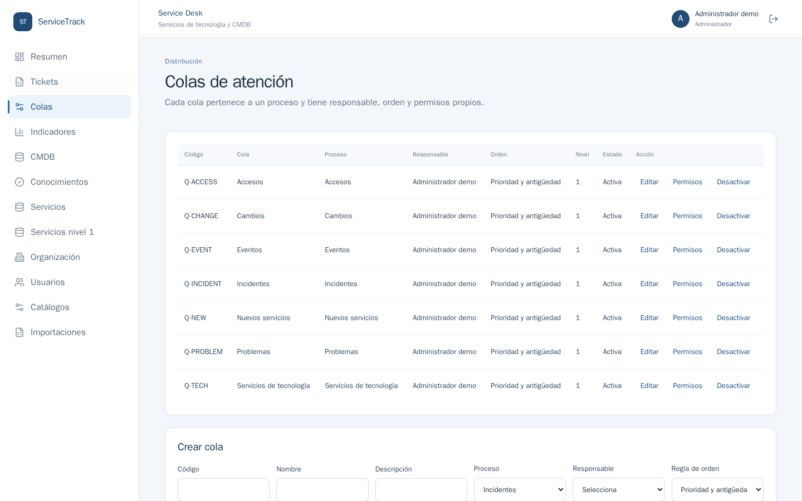
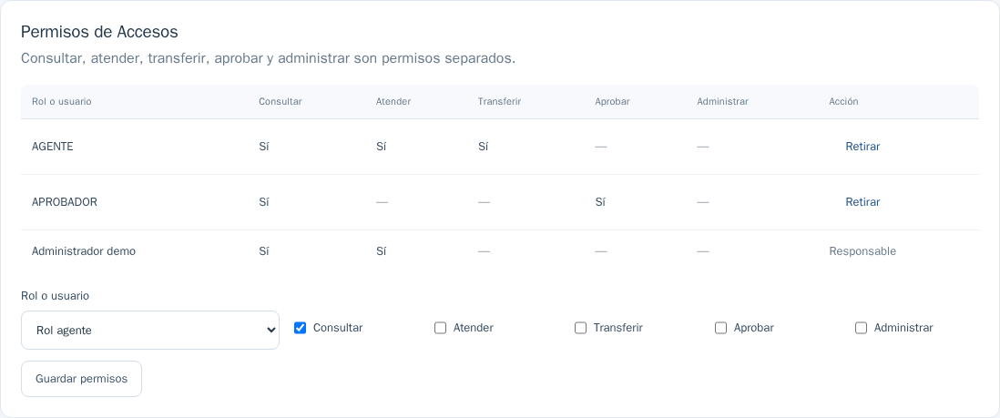

# Guía de defensa: tickets, colas, roles y asignación (16 puntos)

Esta guía se concentra en los apartados **4. Tickets y trazabilidad** y **5. Colas, roles y asignación**. Las seis capturas proceden de la aplicación local con los datos de demostración; se tomaron sin modificar tickets ni colas. Los botones disponibles cambian según el estado del ticket y la cuenta. Para demostrar una operación, efectúala en un ticket de práctica y vuelve a abrir su ficha para mostrar el resultado y la bitácora.

## Antes de entrar al aula

1. Abre el proyecto con Docker Compose como indica el [README](../README.md#inicio-rápido-desde-un-clon-limpio) y confirma que aparece `web`, `api` y `db` en ejecución. La aplicación está en **http://localhost:8080**.
2. Prepara el inicio de sesión `admin.demo`; el [README](../README.md#7-urls-y-cuentas-de-evaluación) contiene las credenciales locales de demostración de administrador, solicitante, agente y consulta. No uses una cuenta personal.
3. Ten abiertas dos pestañas: la aplicación y esta guía. Conserva también [PROCESOS.md](PROCESOS.md#colas-autorización-y-asignación) y [PRUEBAS.md](PRUEBAS.md#colas-permisos-y-asignación) para mostrar las reglas y los resultados observados.
4. Si vas a crear un ticket durante la defensa, usa un título identificable, por ejemplo `DEFENSA - prueba de asignación`. Anota su número. Las capturas de esta guía son referencias visuales; el historial que muestres en vivo dependerá de las acciones que realices.

## Recorrido rápido de 5 minutos

| Tiempo | En pantalla: qué hacer | Qué explicar al catedrático |
|---|---|---|
| 0:00–0:40 | Entra como `admin.demo` → **Tickets**. Señala búsqueda, filtros, tabla y paginación. | “Este es el punto único de entrada. Puedo localizar tickets por número, servicio, proceso, cola, estado, prioridad, responsable y fechas”. |
| 0:40–1:20 | Pulsa **Nuevo ticket**. Recorre **Cola y proceso**, **Servicio existente**, título, descripción, solicitante, prioridad, impacto, urgencia y canal. Baja hasta CI o motivo de no asociar CI. Puedes cerrar sin guardar si el tiempo es escaso. | “El proceso se deriva de la cola; el servicio de nivel 1 se obtiene del servicio de nivel 2. El creador es la cuenta autenticada y puede diferir del solicitante. Un CI es opcional con motivo explícito”. |
| 1:20–2:30 | Abre una fila de la tabla. Muestra datos, fechas y secciones **Acciones**, **Asignar agente**, **Transferir**, **Conversación**, **Evidencias**, **Bitácora**, **CI afectados** y **Tickets relacionados**. Expande **Ver valores anteriores y nuevos** en una entrada de bitácora. | “La ficha reúne clasificación, responsables y trazabilidad. Las operaciones cambian según estado y permiso. El historial conserva actor, fecha y diferencias; no se borra al cambiar el ticket”. |
| 2:30–3:35 | Ve a **Colas**. Enseña las siete colas por proceso y la cola adicional de incidentes. Pulsa **Editar** en una cola para mostrar objetivos y orden; cierra sin guardar. Pulsa **Permisos**. | “Cada cola pertenece a un proceso, tiene responsable, nivel de soporte y objetivos. Los permisos de consultar, atender, transferir, aprobar y administrar se asignan a un rol o usuario por separado”. |
| 3:35–4:15 | Vuelve a **Tickets** y filtra por una cola. Señala **Tomar ticket** si hay uno libre, o **Asignar agente** en una ficha abierta. Si tienes ticket de práctica, ejecuta una asignación y enseña su nueva entrada de bitácora. | “La asignación es manual. La cola ordena por prioridad y antigüedad o por antigüedad y prioridad, con desempate estable. El servidor valida que el agente tenga permiso”. |
| 4:15–5:00 | Abre [PRUEBAS.md](PRUEBAS.md#colas-permisos-y-asignación), filas **P06–P08** y **P15**. Muestra el resultado concurrente **201/409** de P07. | “Las carreras y los rechazos por permisos se prueban de forma automatizada. Dos agentes intentan tomar el mismo ticket: uno lo obtiene y el otro recibe conflicto. Las transferencias y la bitácora también tienen pruebas”. |

Si la defensa dispone de más tiempo, sigue los ejercicios de las secciones siguientes. No necesitas alterar las colas de demostración para explicar una desactivación: muestra el control y la prueba de rechazo cuando hay tickets abiertos.

## 1. Lista, búsqueda, filtros y orden



**Ruta:** menú lateral **Tickets**.

1. Escribe un número `DEMO-` en el buscador y pulsa **Buscar**; limpia el campo para volver a la lista.
2. Selecciona un **Proceso** y una **Cola**. Repite con **Estado**, **Servicio**, **Prioridad**, **Responsable** y el intervalo de fechas. Al final de la tabla usa la paginación.
3. Explica que el orden de una cola usa la regla configurada en **Colas → Editar**. Con varias colas, la vista global usa prioridad descendente y antigüedad ascendente; el ID resuelve empates. La comparación exacta de ambos ordenamientos está en P07.

**Frase útil:** “Los filtros son consultas paginadas al servidor; el orden es reproducible y no depende del navegador”.

## 2. Crear y clasificar un ticket



**Ruta:** **Tickets → Nuevo ticket**.

1. Selecciona una **Cola y proceso** activa; después el **Servicio existente** de nivel 2. Escribe título y descripción.
2. Como administrador, elige un **Solicitante**. La indicación “Creador: cuenta con la que iniciaste sesión” permite mostrar que son campos distintos. El nivel 1 se deriva del servicio elegido.
3. Muestra **Prioridad**, **Impacto**, **Urgencia** y **Canal**. Desplázate hacia abajo para mostrar los campos propios del proceso seleccionado.
4. Si corresponde, vincula uno o varios CI. Para un trámite sin equipo afectado, registra el motivo de ausencia de CI; no selecciones un dispositivo ficticio.
5. Si vas a guardar, usa un título `DEFENSA - ...`, toma nota del número generado y abre la ficha. Si el tiempo es corto, cierra el formulario sin guardar y usa un ticket `DEMO-*`.

**Qué valida la API:** servicio, cola, solicitante y CI existentes, campos obligatorios y datos específicos del proceso. P05 comprueba referencias válidas e inválidas.

## 3. Ficha y operaciones del ciclo de vida



**Ruta:** clic en una fila de **Tickets**.

Señala el número único, título, descripción, solicitante, creador, servicio de nivel 2 y nivel 1 derivado, tipo, proceso, cola, responsable, estado, prioridad, impacto, urgencia, canal y fechas. Las fechas de resolución y cierre aparecen cuando aplican. Después desplázate por estas secciones:

| Sección o control | Acción demostrable | Resultado que debes enseñar |
|---|---|---|
| **Acciones → Tomar ticket** | Abre uno sin responsable con una cuenta agente autorizada y pulsa **Tomar ticket**. | Aparece el responsable y una entrada de asignación. Si ya está tomado, el botón no aparece. |
| **Asignar agente** | Como administrador, selecciona un agente activo de la lista y pulsa **Asignar**. | La lista ofrece agentes autorizados para atender esa cola; la bitácora registra anterior/nuevo. |
| **Acciones → [siguiente estado]** | En un ticket de práctica, pulsa el estado permitido que muestre la ficha. Completa antes el motivo o la evidencia exigida. | El estado y la fecha cambian; la bitácora conserva actor y valores. Clasificación, atención, resolución y cierre usan transiciones del proceso, no edición libre del estado. |
| **Transferir** | Selecciona otra cola **del mismo proceso**, escribe un motivo y pulsa **Transferir**. | Cambia la cola, queda registrado el motivo y el responsable previo deja de estar asignado. Si no hay otra cola válida, muestra P08 en vez de crear una artificial en vivo. |
| **Escalar incidente** | En un incidente atendible, selecciona cola de incidentes con nivel de soporte mayor, escribe motivo y pulsa **Escalar**. | Cambian cola y estado en una transacción. No basta con marcar manualmente “Escalado”. |
| **Resolver / Cerrar / Reabrir** | Avanza mediante los botones que permita el estado. Para resolver, completa la solución; cierra después. Si el ticket cerrado cumple la ventana y permisos, usa **Reabrir** con motivo. | Muestra `resolved_at`, `closed_at`, contador de reaperturas y entradas de historial. P15 prueba cierres inválidos y reapertura. |
| **Pausar / Reanudar** | En un ticket atendible, usa estos controles con motivo. | Se refleja la pausa y su trazabilidad; los indicadores consideran ese intervalo según [PROCESOS.md](PROCESOS.md). |

Los botones exactos varían según proceso, estado y rol. Si un botón no aparece, di qué condición falta y usa la prueba correspondiente para mostrar el rechazo del servidor. No fuerces un proceso a un estado solo para la presentación.

## 4. Conversación, adjuntos, relaciones y auditoría



1. En **Conversación**, muestra el selector **Visible al solicitante / Nota interna**. El agente puede elegir; el solicitante ve solo lo público. Puedes escribir un comentario de práctica y luego verlo con la otra cuenta.
2. En **Evidencias**, muestra **Adjuntar**. La interfaz admite PDF, PNG, JPG/JPEG y TXT; el servidor valida tamaño, tipo y descarga autenticada/autorizada. P05 comprueba rechazo de firma inválida, descarga anónima `401` y descarga permitida `200`. Usa un archivo de prueba sin datos personales.
3. En **Bitácora**, abre **Ver valores anteriores y nuevos** en una asignación o transición. Señala actor, fecha, acción, valor anterior y valor nuevo. La entrada `DEMO_SEED` identifica el estado de muestra insertado durante la preparación; para mostrar una operación real, utiliza una entrada generada en vivo o P07/P15.
4. En **CI afectados**, muestra los CI vinculados o el motivo explícito de ausencia registrado en el ticket. En **Tickets relacionados**, enseña vínculos existentes o el formulario **Vincular** con ID y tipo de relación.

**Frase útil:** “La bitácora es persistente: la aplicación agrega acciones, no sustituye el historial al editar el ticket”.

## 5. Colas, objetivos, roles y permisos



**Ruta:** menú lateral **Colas**.

1. Cuenta las colas de los siete procesos: nuevos servicios, cambios, incidentes, eventos, problemas, accesos y servicios de tecnología. La preparación actual también crea una cola adicional de incidentes con nivel superior para practicar escalamiento; si solo aparecen siete en una instalación antigua, vuelve a ejecutar el script de preparación indicado en el README.
2. Señala **Código**, **Cola**, **Proceso**, **Responsable**, **Orden**, **Nivel**, **Estado** y los controles **Editar**, **Permisos** y **Desactivar**. Una cola configura exactamente un proceso; un proceso puede tener varias colas.
3. Pulsa **Editar** para enseñar descripción, responsable, nivel de soporte, regla `Prioridad y antigüedad` o `Antigüedad y prioridad`, y objetivos de primera respuesta y resolución. Cierra sin guardar si estás enseñando las colas de muestra.
4. Para demostrar alta y baja lógica sin afectar la muestra, crea una cola de prueba con código único, proceso y responsable activo. Después edítala y desactívala **solo si no tiene tickets abiertos**. La aplicación rechaza desactivar una cola con tickets abiertos; P06 verifica ese caso.



5. Pulsa **Permisos** en una cola. Explica las cinco columnas independientes: **Consultar**, **Atender**, **Transferir**, **Aprobar**, **Administrar**. En **Rol o usuario**, muestra que se puede asignar a `AGENTE`, `APROBADOR` o a una cuenta individual. El responsable conserva consulta y atención; primero hay que sustituirlo para retirar esa concesión.
6. Cierra sesión y entra como `consulta.demo`. Abre tickets para mostrar lectura y ausencia de acciones de mantenimiento. La prueba P01/P06 confirma que el servidor también rechaza escrituras, aunque se intente llamar directamente a la API. Entra como `solicitante.demo` para mostrar que consulta sus propios tickets; `agente1.demo` ve las colas autorizadas.

**Frase útil:** “La pertenencia a una cola no convierte el rol de consulta en editor. Los permisos se verifican de nuevo en la API”.

## 6. Asignación, concurrencia y tickets sin responsable

La política documentada es **manual**. Un agente con permiso `Atender` puede reclamar un ticket libre; un administrador global o con permiso `Administrar` en esa cola puede asignarlo a un agente habilitado. La API bloquea la fila del ticket durante el reclamo o la reasignación. Por eso, ante dos reclamos simultáneos, solo uno gana. P07 obtuvo respuestas `201` y `409`; es evidencia de concurrencia, no algo que deba simularse con dos clics sucesivos.

Para enseñarlo, abre [PRUEBAS.md, sección “Colas, permisos y asignación”](PRUEBAS.md#colas-permisos-y-asignación) y señala **P07**. Allí constan el orden de ambas reglas, el reclamo concurrente, la asignación permitida y los rechazos. Si el ingeniero pide ejecutar todas las pruebas de aceptación, desde la raíz del clon usa:

```powershell
# Windows PowerShell
powershell -NoProfile -ExecutionPolicy Bypass -File scripts/service-desk-test.ps1
```

```sh
# Linux o macOS
sh scripts/service-desk-test.sh
```

La rutina usa un proyecto Compose y datos aislados. Puede tardar más que una defensa de cinco minutos; para la exposición corta, enseña el resultado registrado y ofrece ejecutar el comando si te lo solicitan. P06 comprueba que retirar permisos, desactivar colas o desactivar usuarios con responsabilidades abiertas no deje tickets huérfanos. P08 cubre transferencia, motivo y validación de cola destino. P15 cubre cierre, reapertura y bitácora.

## Matriz para responder preguntas

| Lo que te pueden pedir | Dónde lo muestras | Prueba del servidor |
|---|---|---|
| Alta, consulta y clasificación | **Tickets → Nuevo ticket** y ficha | P05, P09 |
| Asignar, tomar, orden y doble reclamo | **Tickets → ficha**, **Colas → Editar** | P06–P07 |
| Transferir y escalar | **Ficha → Transferir / Escalar incidente** | P08 |
| Resolver, cerrar, reabrir y no borrar historial | **Ficha → Acciones / Bitácora** | P15 |
| Comentarios públicos y notas internas | **Ficha → Conversación**; comparar agente y solicitante | P05/P15 y control de acceso |
| Adjunto seguro | **Ficha → Evidencias** | P05 |
| CI opcional y tickets relacionados | **Nuevo ticket / ficha** | P05 y P13 |
| Búsqueda, filtros y paginación | **Tickets** | P05/P07 |
| Alta, edición y baja lógica de colas | **Colas** | P06 |
| Permisos por rol y usuario; consulta solo lectura | **Colas → Permisos** y cambio de cuenta | P01/P06 |
| Evitar huérfanos por desactivación | **Colas → Desactivar**; explicar la política | P06 |

**Archivos para abrir si preguntan “¿dónde está implementado?”:** [política y procesos](PROCESOS.md#colas-autorización-y-asignación), [resultados de pruebas](PRUEBAS.md#colas-permisos-y-asignación), [servicio de la API](../apps/api/src/desk/desk.service.ts), [pantallas](../apps/web/src/DeskPages.tsx). Las capturas se pueden regenerar con `e2e/capture-presentation.cjs` dentro del contenedor Playwright; ese script únicamente navega y toma imágenes.
