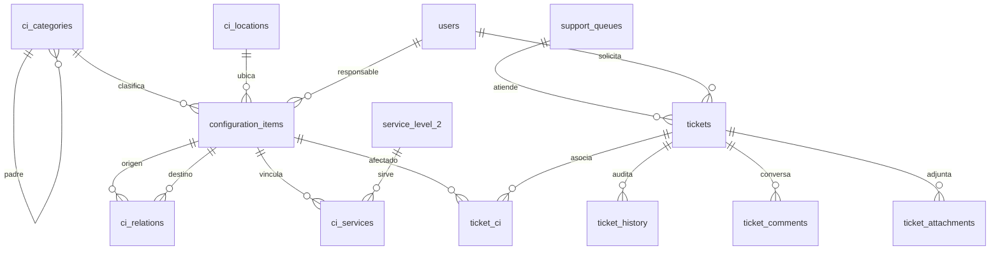

# Modelo de la ampliación Service Desk

## Fuentes y alcance

El catálogo y la organización del parcial 2 permanecen en la migración 001.
La migración 002 agrega CMDB, colas, roles y tickets. Los originales se
conservan en `data/fuentes/` sin edición.

| Fuente | Localización comprobada | Uso |
|---|---|---|
| CMDB.xlsx | hoja `CMDB`, encabezados B4:U4, ejemplos B5:U6 | campos y tipos Hardware/Software |
| leccion22_Transicion.pdf | diapositivas 10-12, 14, 16-19 | SACM, CI, atributos, relaciones, cambios y conocimiento |
| Service Desk.pdf | diapositivas 11-16 | soporte 0-4, tipos, eventos E0-E3 e incidentes I0-I6 |
| Tarea_Service_Desk.pdf | apartados 3-12 | requisitos funcionales y de prueba de esta entrega |

El Excel contiene dos CI de muestra, no una taxonomía completa. Se preservan
`Hardware` y `Software` como tipos de origen (`source_kind=EXCEL`).
`Servidor`, `Estación de trabajo`, `Equipo de red` y `Almacenamiento`
son subcategorías sintéticas (`source_kind=PROJECT`) para distribuir los
5,000 dispositivos exigidos por la tarea. No se atribuyen a la lección.

La clase también explicó que la jerarquía práctica se refiere a modelar los
campos y relaciones de CMDB con integridad referencial, y que la KDB de errores
conocidos no es un módulo obligatorio. Por ello distinguimos la jerarquía
configurable de clasificación de las relaciones técnicas entre CI.

## Diagrama de entidades



## Mapeo CMDB.xlsx

| Columna de origen | Campo o relación |
|---|---|
| Nombre del CI | `configuration_items.name` |
| Tipo de CI | `ci_categories` |
| Descripción | `configuration_items.description` |
| Número de Serie | `configuration_items.serial_number` |
| Versión | `configuration_items.version` |
| Fecha de Adquisición | `configuration_items.acquired_on` |
| Estado Actual | `configuration_items.status` |
| Relaciones | `ci_relations` |
| Padres/Hijos | `ci_relations`, sin confundir con `ci_categories.parent_id` |
| Ubicación Física | `configuration_items.location`, ubicación controlada opcional en `ci_locations` |
| Propietario/Responsable | `responsible_user_id` o `responsible_label` cuando la fuente solo da un equipo |
| Fecha de Cambio y Descripción del Cambio | `ci_history.created_at` y `description` |
| Documentación relacionada | `documentation_url` |
| Enlaces a Incidentes y Problemas | `ticket_ci` y tipo de ticket |
| Niveles de Seguridad | `security_level` |
| Cumplimiento | `compliance_status` |
| Estado de Configuración | `configuration_status` |
| Número de Licencia | `license_number` |
| Fecha de Vencimiento | `license_expires_on` |

El archivo muestra algunos encabezados con codificación defectuosa. El
significado se normaliza en nombres de columnas de la aplicación y el original
se conserva byte a byte.

## Campos añadidos por el proyecto

`configuration_items.code`, `is_device`, `category_id`, `location_id`,
`responsible_user_id`, `technical_attributes`, `synthetic_seed` y marcas
de tiempo son campos operativos nuevos. No se presentan como campos del Excel.

## Reglas de integridad

- La clasificación tiene un solo padre por categoría, rechaza padres
  inexistentes o inactivos y ciclos.
- `DEPENDS_ON`, `HOSTED_ON` y `PARENT_OF` rechazan ciclos; `CONNECTED_TO`
  permite redes bidireccionales o cíclicas.
- Un recorrido de dependencias reporta servicios *potencialmente afectados*;
  la relación no prueba una interrupción real.
- El generador solo cuenta `is_device=true` y la semilla identifica el
  conjunto. Una segunda ejecución con la misma semilla omite códigos existentes.

## Verificación inicial en Docker aislado

Se ejecutó en el proyecto Compose `service-desk-dev`:

```text
migration 001_init.sql: applied
migration 002_service_desk_foundation.sql: applied
CMDB_SEED=CHECK1, CMDB_COUNT=12: created=12, skipped=0
CMDB_SEED=CHECK1, CMDB_COUNT=12: created=0, skipped=12
CMDB_SEED=EVAL2026, CMDB_COUNT=5000: created=5000, skipped=0
CMDB_SEED=EVAL2026, CMDB_COUNT=5000: created=0, skipped=5000
```

Estas salidas verifican la migración y la idempotencia inicial del generador.
No acreditan todavía los escenarios P01-P18 de la ampliación.
