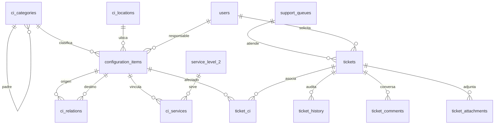

# Modelo de la ampliación Service Desk

## Fuentes y alcance

El catálogo y la organización del parcial 2 permanecen en la migración 001.
La migración 002 agrega CMDB, colas, roles y tickets. El enunciado original
del parcial 2 está preservado como texto en `docs/contexto/enunciado.md`;
el catálogo original está en `data/CatalogoServicios.xlsx`. Las fuentes
recibidas para la ampliación se conservan en `data/fuentes/` sin edición.

| Fuente | Localización comprobada | Uso |
|---|---|---|
| Enunciado del parcial práctico 2 | `docs/contexto/enunciado.md`, 459 líneas | requisitos originales del catálogo, organización, autenticación e importación; corresponde al contenido llamado `Parcial Practico 2.pdf` en la nueva tarea |
| CatalogoServicios.xlsx | `data/CatalogoServicios.xlsx`, hoja `Servicios Externos` | 12 códigos de nivel 1 y 46 servicios de nivel 2; origen del catálogo reutilizado |
| CMDB.xlsx | hoja `CMDB`, encabezados B4:U4, ejemplos B5:U6 | campos y tipos Hardware/Software |
| leccion22_Transicion.pdf | diapositivas 10-12, 14, 16-19 | SACM, CI, atributos, relaciones, cambios y conocimiento |
| Service Desk.pdf | diapositivas 11-16 | soporte 0-4, tipos, eventos E0-E3 e incidentes I0-I6 |
| Tarea_Service_Desk.pdf | apartados 3-12 | requisitos funcionales y de prueba de esta entrega |

El contenido del enunciado del parcial 2 se suministró a este proyecto como
texto. La copia versionada coincide byte por byte con el texto adjuntado
por el estudiante el 26 de octubre de 2026 (19,323 bytes; SHA-256
`2877b91f9bdf95932638b8e2412efa55eecab86c53e35c0eb5278454c10c1e9e`).
La referencia `Parcial Practico 2.pdf` en la tarea nueva designa ese
enunciado por su contenido; no se presenta un PDF reconstruido como fuente
original. El enunciado del parcial 3 está en `data/fuentes/Tarea_Service_Desk.pdf`.

El Excel contiene dos CI de muestra, no una taxonomía completa. Se preservan
`Hardware` y `Software` como tipos de origen (`source_kind=EXCEL`).
`Servidor`, `Estación de trabajo`, `Equipo de red` y `Almacenamiento`
son subcategorías sintéticas (`source_kind=PROJECT`) para distribuir los
5,000 dispositivos exigidos por la tarea. No se atribuyen a la lección.

La clase también explicó que la jerarquía práctica se refiere a modelar los
campos y relaciones de CMDB con integridad referencial, y que la KDB de errores
conocidos no es un módulo obligatorio. Por ello distinguimos la jerarquía
configurable de clasificación de las relaciones técnicas entre CI.

## Diagrama de entidades



## Mapeo CMDB.xlsx

| Columna de origen | Campo o relación |
|---|---|
| Nombre del CI | `configuration_items.name` |
| Tipo de CI | `ci_categories` |
| Descripción | `configuration_items.description` |
| Número de Serie | `configuration_items.serial_number` |
| Versión | `configuration_items.version` |
| Fecha de Adquisición | `configuration_items.acquired_on` |
| Estado Actual | `configuration_items.status` |
| Relaciones | Texto original en `technical_attributes.originalRelations`; solo se crea `ci_relations` cuando existe CI destino y se conoce el tipo de relación |
| Padres/Hijos | Texto original en `technical_attributes.originalParentsChildren`; no se convierte automáticamente en `ci_categories.parent_id` |
| Ubicación Física | `configuration_items.location`, ubicación controlada opcional en `ci_locations` |
| Propietario/Responsable | `responsible_user_id` o `responsible_label` cuando la fuente solo da un equipo |
| Fecha de Cambio y Descripción del Cambio | Valores originales en `technical_attributes.sourceChangeDate` y `sourceChangeDescription`; `ci_history` registra el momento de importación, no suplanta la fecha del Excel |
| Documentación relacionada | Valor original en `technical_attributes.originalDocumentation`; `documentation_url` es la referencia estructurada que se completa en la aplicación |
| Enlaces a Incidentes y Problemas | Texto original en `technical_attributes.originalIncidentLinks`; nuevas relaciones verificadas en `ticket_ci` |
| Niveles de Seguridad | `security_level` |
| Cumplimiento | `compliance_status` |
| Estado de Configuración | `configuration_status` |
| Número de Licencia | `license_number` |
| Fecha de Vencimiento | `license_expires_on` |

El archivo muestra algunos encabezados con codificación defectuosa. El
significado se normaliza en nombres de columnas de la aplicación y el original
se conserva byte a byte.

## Campos añadidos por el proyecto

`configuration_items.code`, `is_device`, `category_id`, `location_id`,
`responsible_user_id`, `technical_attributes`, `synthetic_seed` y marcas
de tiempo son campos operativos nuevos. No se presentan como campos del Excel.

## Reglas de integridad

- La clasificación tiene un solo padre por categoría, rechaza padres
  inexistentes o inactivos y ciclos.
- `DEPENDS_ON`, `HOSTED_ON` y `PARENT_OF` rechazan ciclos; `CONNECTED_TO`
  permite redes bidireccionales o cíclicas.
- Un recorrido de dependencias reporta servicios *potencialmente afectados*;
  la relación no prueba una interrupción real.
- El generador solo cuenta `is_device=true` y la semilla identifica el
  conjunto. Una segunda ejecución con la misma semilla omite códigos existentes.

## Verificación inicial en Docker aislado

Se ejecutó en el proyecto Compose `service-desk-dev`:

```text
migration 001_init.sql: applied
migration 002_service_desk_foundation.sql: applied
CMDB_SEED=CHECK1, CMDB_COUNT=12: created=12, skipped=0
CMDB_SEED=CHECK1, CMDB_COUNT=12: created=0, skipped=12
CMDB_SEED=EVAL2026, CMDB_COUNT=5000: created=5000, skipped=0
CMDB_SEED=EVAL2026, CMDB_COUNT=5000: created=0, skipped=5000
```

Estas salidas verifican la migración y la idempotencia inicial del generador.
La ejecución final de P01–P18 se documenta en [PRUEBAS.md](PRUEBAS.md).

## Importación real de CMDB.xlsx

La migración 004 crea `cmdb_import_runs` y `cmdb_import_observations`. `import-cmdb.ts` verifica hoja, 20 encabezados, nombre, tipo, ubicación, responsable, fechas, tipos de celda y duplicados de origen **antes** de abrir la transacción. Una estructura inválida termina con código de salida distinto de cero y no cambia la base. Cada fila usa un código estable (`CMDB-XLSX-5` y `CMDB-XLSX-6`), con actualización si varían los campos e ignorado si son idénticos. La transacción incluye el historial de CI y las observaciones.

Las dos filas contienen `Base de Datos1` en Relaciones, pero ese CI no existe en la hoja. Se conserva el texto original y se emite una observación por fila. La ausencia de un destino y de un tipo de relación impide crear una arista técnica verificable. El SHA-256 del archivo original leído en la prueba es `d182796bb40b492be2cb87e2c5fe19a8f910f2e754183dc48b5e89bd360464dc`.

## Diccionario de datos operativo

| Entidad | Identidad y claves | Restricciones principales |
|---|---|---|
| `ci_categories` | `id`, `code` único, `parent_id` opcional | Un padre por categoría; `source_kind` distingue Excel y proyecto; se rechazan ciclos |
| `ci_locations` | `id`, `code` único | Ubicaciones controladas para dispositivos generados |
| `configuration_items` | `id`, `code` único, `category_id` obligatorio | Estado, ubicación y responsable; `is_device` diferencia equipo del CI de origen; `source_reference` y `technical_attributes` guardan procedencia |
| `ci_relations` | `from_ci_id`, `to_ci_id`, `relation_type` | FKs a CI; `DEPENDS_ON`, `HOSTED_ON`, `PARENT_OF` sin ciclos; `CONNECTED_TO` admite ciclos |
| `ci_services` | `ci_id`, `service_id` | Relación con servicio de nivel 2 existente |
| `ci_history` | `ci_id`, acción, fecha | Historial de cambios del sistema; no equivale a la fecha histórica del Excel |
| `cmdb_import_runs` | `id`, archivo, SHA-256, hoja | Totales creados, actualizados, omitidos y observados |
| `cmdb_import_observations` | `run_id`, fila, campo | Registra ambigüedades sin inventar relaciones |
| `support_queues` | `id`, `code` único, `process` | Un proceso por cola; objetivos de primera respuesta y resolución en minutos calendario |
| `queue_grants` | `queue_id` más usuario o rol | Permisos separados de consulta, atención, transferencia, aprobación y administración |
| `tickets` | `id`, `number` único, FKs de servicio, cola y personas | Servicio nivel 1 derivado; estado, prioridad, impacto, urgencia, canal, fechas y datos propios del proceso |
| `ticket_ci`, `ticket_links` | pares de IDs | CI afectados y vínculos entre tickets; motivo obligatorio si no hay CI |
| `ticket_history`, `ticket_comments`, `ticket_attachments` | FK a ticket | Bitácora con actor y valores; visibilidad pública/interna; descarga autorizada |

La jerarquía organizacional del catálogo (`Empresa → Área → Departamento → Sección → Puesto → Usuario`) y la clasificación de CI son grafos distintos. El Excel CMDB solamente proporciona las raíces Hardware y Software; la lección 22 define el concepto de CI y relaciones, sin enumerar en la copia suministrada una taxonomía exhaustiva de equipos. Por eso la clasificación permite añadir hijos y las cuatro hojas sintéticas están marcadas como decisión `PROJECT`.
